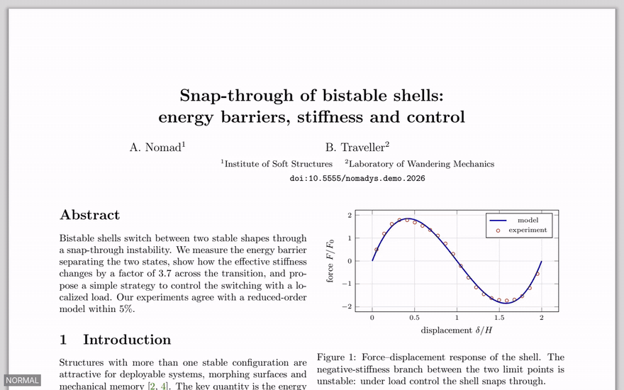
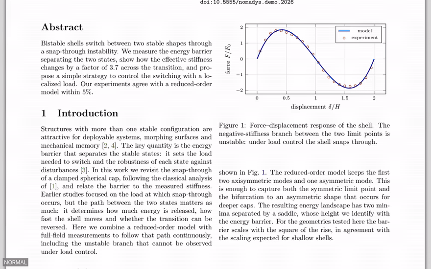
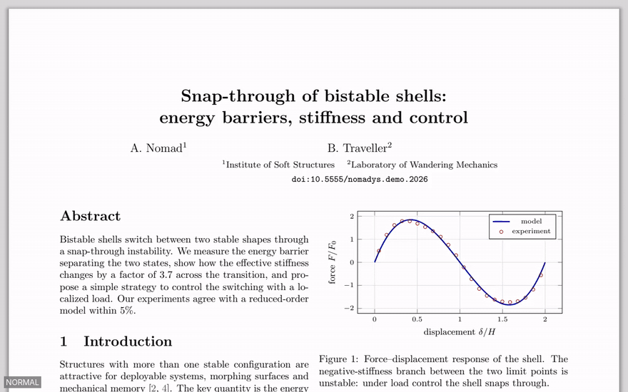
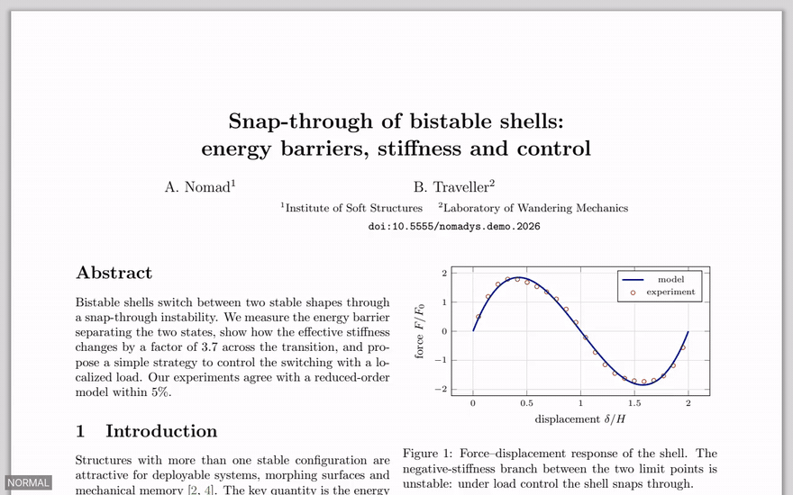
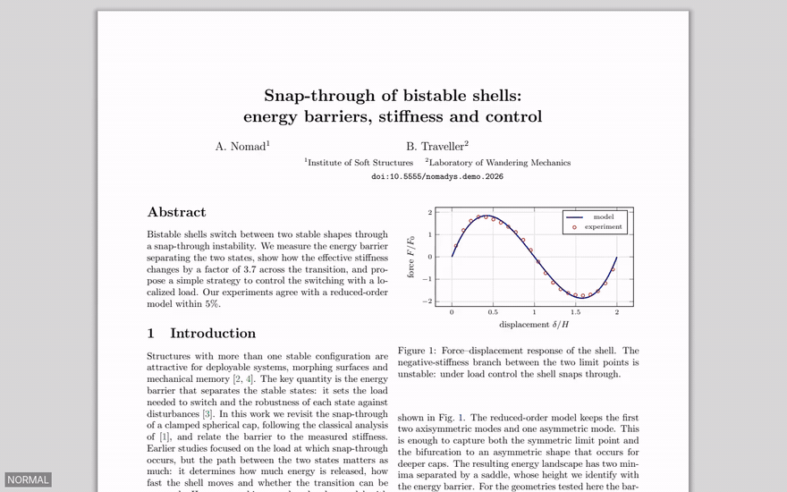
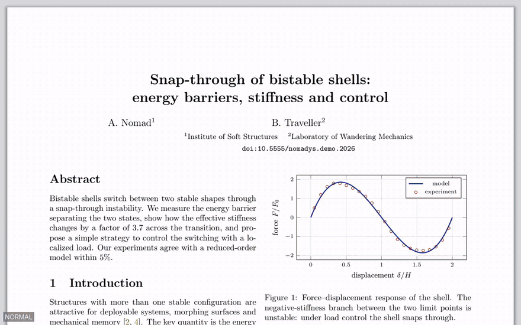
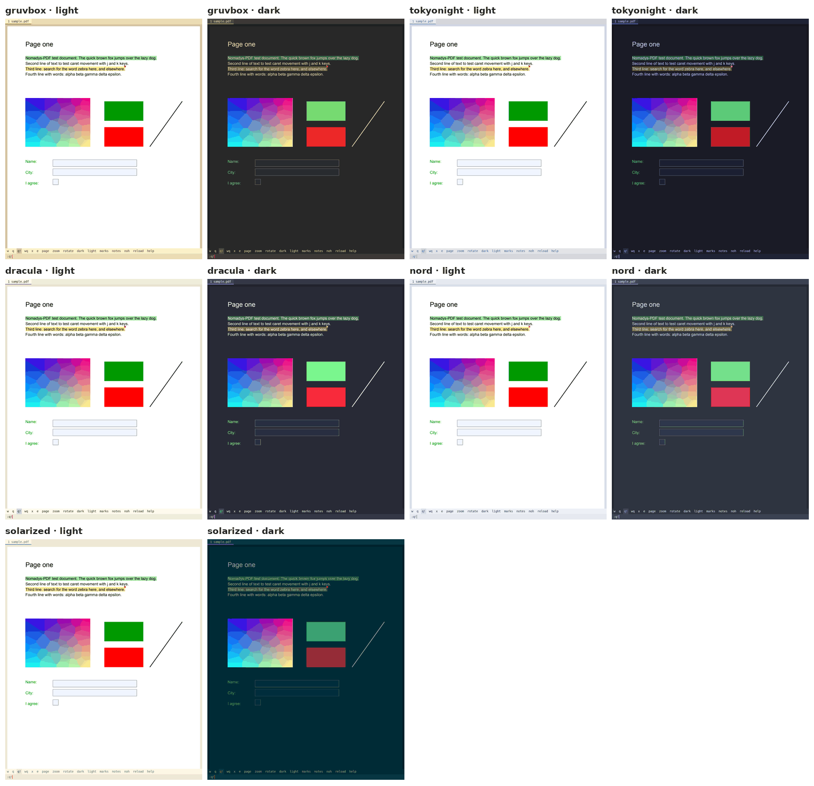

# Nomadys-PDF


**For people who read PDFs for hours on end.**
If you spend your days inside papers, books and reports, you know the
choice: readers bloated with toolbars, side panels, accounts and cloud sync,
or bare viewers that leave you alone with the page. Nomadys-PDF sits in
between: a minimal, fast, keyboard-driven reader for Linux (the page gets
the whole window, and everything is one or two keys away) that brings the
quality-of-life tools that make long reading sessions easier.

Made first for **researchers who love keyboard-driven tools**, but anyone
can use it: the mouse scrolls, follows links and selects text, and `\c`
shows every key.

Free and open source, for everyone. If it saves you time, you can
[buy me a coffee](https://ko-fi.com/hugooliveira35800).



## Why I am developing it

I could not find a PDF reader for Linux that fit the way I work.
[Zathura](https://pwmt.org/projects/zathura/) is great, but too limited for
the daily work of a researcher who reads and writes papers.
[Sioyek](https://sioyek.info/) is very good, but it did not give me the flow
I wanted either. For anything beyond reading, I kept falling back on Master
PDF Editor, PDF Studio or even online tools to do basic things.

What I wanted was simple to say:

- **vim-friendly** through and through: every action from the keyboard, with
  the keys a vim user already knows;
- a **minimal** window: the page, and nothing else on screen;
- **tabs**, split view and sessions;
- **themes** I can switch in a second, with a dark mode that respects figures;
- **highlights and comments** saved in the PDF itself, so every other reader
  shows them, with LaTeX equations in the comments;
- a real **search**, in the paper and across all the papers I own;
- a good companion for **LaTeX and Vim** (SyncTeX, auto-reload);
- the basic things done in place: **printing**, filling in **forms**,
  moving or extracting **pages**, placing a **signature** or an image.

Nothing ticked all of these boxes, so I started writing my own PDF reader.
With the help of [Claude](https://claude.com/product/claude-code) I could
move forward a lot, and quickly. I hope it is as useful to you as it is to me.

*Nomadys*: a nomad, with no fixed place, always looking for something
better. The icon is a tent at home anywhere, a trail towards the mountain
and the rising sun, and a page lit in the doorway: reading goes wherever
you go.

## What it does

**Reading**
- vim keys: `j` `k`, `gg` `G`, `42G`, counts (`5j`), marks, a jump history
  (`Ctrl-o` / `Ctrl-i`)
- zoom, fit width or page, two pages side by side, rotation; each file
  reopens where you left it, with its own zoom and dark mode
- `f` follows any link by typing its letters; `F` **previews** a citation,
  figure or equation in place, without losing your page
- a panel with the table of contents, your marks and all your highlights
- a dark mode that recolours text and plots but keeps photographs and the
  pictures you placed, with readable highlights and firm letters
- presentation mode (`F5`)

**Annotating**
- a text cursor and a free cursor for figures, highlights in five colours,
  comments with **LaTeX equations** typeset as you write
- all stored as standard PDF annotations (Acrobat, Okular, Zotero… show them)
- **tasks**: `t` puts a highlight or comment on your task list, with a check
  box in the margin, `d` marks it done; the panel's Tasks tab lists what is
  left and what is done, `:tasks` what is still to do in all your PDFs, and
  Markdown export writes `- [ ]` / `- [x]`
- undo and redo everything; filter by colour; export to Markdown
- merge a co-author's highlights and comments into your copy
- **answer the reviewers**: `r` replies to a comment they left in the PDF
  (Acrobat and Okular show it in the thread), `:response` writes the
  response letter in Markdown: each point, your reply, what is left
- place images and signatures; move, resize, crop them

**Searching**
- incremental search in the PDF, smart case
- `\/` searches the **text of every PDF you own**, `\n` every comment you
  ever wrote; `\f` finds any PDF by name; `\o` opens recent files
- `:diff old.pdf` compares two versions word by word

**Writing with LaTeX**
- SyncTeX both ways with Vim / Neovim (VimTeX), automatic reload
- `Y` copies a quotation with its page, `:bibtex` the paper's BibTeX entry
- copy a figure as an image for slides

**Everything else**
- tabs, split view (`Ctrl-w v`), several windows, sessions
- fifteen themes (gruvbox, catppuccin, tokyonight, nord, flexoki, github,
  one, ayu, …), each with a light and a dark side, all checked for contrast,
  or your own; any system font
- a page grid (`\g`): choose pages one by one (`Space`) or a run (`v`), then
  delete, turn, move them with the arrows, or save just those as a new PDF;
  insert another PDF
- forms, printing through CUPS, password-protected and signed PDFs
- light on memory, and fast on heavy pages (they render a slice at a time)

## See it

| | |
|---|---|
|  |  |
| `t`: a highlight goes on the task list, `d` ticks it | `F`: preview a reference in place |
|  |  |
| `Y`: copy a quotation with its page number | `\/`: search the text of every PDF |
|  |  |
| `:diff`: what changed since the submitted version | `Ctrl-w v`: the figure and the text side by side |
|  |  |
| `\g`: choose pages apart, turn them, move a block | `i`: dark mode that keeps photographs |
|  | |
| `\T`: try the themes live | |

### The themes

Each theme has a light and a dark side (`i` switches while reading):



## Install

Linux (Wayland or X11). On Debian / Ubuntu:

```sh
sudo apt install build-essential pkg-config libsdl3-dev libfreetype-dev libfontconfig-dev zlib1g-dev
git clone https://github.com/hdsoliveira/Nomadys-PDF.git
cd Nomadys-PDF
make && make install        # installs npdf in ~/.local/bin
```

The PDF engine, [PDFium](https://pdfium.googlesource.com/pdfium/) (the one
in Chrome), is downloaded and checked automatically by the first `make`.
Optional: TeX Live (equations in comments, SyncTeX), `curl` (`:bibtex`),
CUPS (printing). `make uninstall` removes everything.

## First steps

```sh
npdf paper.pdf              # or several files: one tab each
npdf                        # your last session
```

| Key | |
|---|---|
| `\c` | **every key**, for the mode you are in |
| `j` `k` / `J` `K` / `gg` `G` | scroll / page / first, last |
| `+` `-` `=` / `i` | zoom, fit width / dark mode |
| `/` then `n` `N` | search |
| `v`, `v`, then `C` `V` `B` `N` `M` / `c` | highlight in a colour / with a comment |
| `u` / `Ctrl-r` | undo / redo |
| `f` / `F` | follow / preview a link |
| `\l` / `\g` | panel / all pages |
| `\/` / `\f` | search all your PDFs / find a PDF |
| `:w` / `:q` | save (it also saves by itself) / close |
| `Esc` | back to reading, from anywhere |

## Documentation

The [wiki](docs/wiki/Home.md) explains every feature, with the full
[keyboard reference](docs/wiki/Keyboard-Reference.md), the
[commands](docs/wiki/Commands.md) and the
[configuration](docs/wiki/Configuration.md). The same pages are part of the
website in [`site/`](site/README.md).

A taste of the configuration (`~/.config/nomadys-pdf/config`):

```ini
include = catppuccin          # the theme (\T chooses one live)
font = JetBrains Mono
font_size = 11
pdf_dirs = ~/Papers, ~/Books  # where \f and \/ look
```

## Little things that add up

- **Reopens where you left off**: each file keeps its page, zoom and dark
  mode; `npdf` alone brings back your last session
- **Never lose your place**: `Ctrl-o` jumps back after any jump, `F`
  previews a reference without leaving the page
- **Every link by its letters**: `f` then the letters shown on the link
- **Find any paper**: `\f` by name, `\/` by its text, `\o` the recent ones
- **Notes that travel**: highlights and comments saved in the PDF, shown by
  every other reader
- **A to-do list in your papers**: `t` puts a highlight on it, `d` ticks it;
  `:tasks` shows what is left in all of them
- **Undo anything**: highlights, comments, images, deleted pages
- **Easy on the eyes**: a dark mode that keeps photographs, fifteen themes,
  any system font
- **No learning wall**: `\c` shows every key of the mode you are in, and
  messages say what the next key does

## Support

Nomadys-PDF has no ads, no accounts and no paid version: I build it in my
free time and share it with everyone. A star helps others find it, and every
bug report or idea in the
[issues](https://github.com/hdsoliveira/Nomadys-PDF/issues) makes it better.
If it saves you time, you can also buy me a coffee:

[](https://ko-fi.com/hugooliveira35800)

## Development

Written in C (SDL3, FreeType, fontconfig, PDFium, stb). `make` builds
`./npdf`. Every change is checked with AddressSanitizer and
UndefinedBehaviorSanitizer on a collection of broken PDFs and random key
sequences: `tests/qa/run.sh`. The code is organised one feature per file in
`src/`, with the shared types in `src/nomadys.h`.

## Licence

MIT (`LICENSE`), by Hugo Oliveira. The libraries it uses (PDFium and the
libraries inside it, SDL3, FreeType, fontconfig, zlib, stb) and the colour
themes it follows are all under permissive licences: see
[`licenses/`](licenses/README.md) for the list and the texts. `make install`
copies them to `share/doc/nomadys-pdf/`.

Portions of this software are copyright © The FreeType Project
(www.freetype.org). All rights reserved. This software is based in part on
the work of the Independent JPEG Group.
